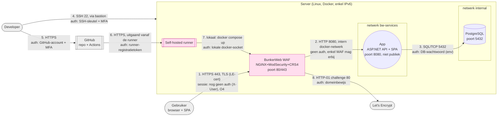

# Threat model Unbreakable — bijgewerkt na opdracht 2

Dit model groeit mee met elke opdracht. Opdracht 1 legde de basis (architectuur,
STRIDE, vereisten). Opdracht 2 voegt de **pipeline** en de **WAF (BunkerWeb)** toe,
zet op elke data flow het **protocol** en de **authenticatie**, en beschrijft de
**nieuwe dreigingen** die de pipeline en de WAF zelf meebrengen.

> Opdracht-nummering (gecorrigeerd volgens de semesterplanning):
> **O3** = cryptografie · **O4** = identity (Keycloak) · **O5** = access (OPA/Rego) ·
> **O6** = secrets (OpenBao).

## Architectuur en data flows

**Vertrouwensgrenzen:** internet ↔ server (enkel via de WAF), WAF ↔ app-netwerk,
app ↔ databank-netwerk, en de pipeline (GitHub) ↔ server (via de self-hosted runner).

## Dreigingen (STRIDE)

Bestaande dreigingen uit opdracht 1 blijven; hieronder de stand na opdracht 2.
Opdr. = opdracht waarin de maatregel (verder) wordt uitgewerkt. "O2 ✓" = nu aangepakt.

| # | STRIDE | Dreiging (element) | Maatregel | Opdr. |
|---|---|---|---|---|
| T2 | I | Afluisteren van verkeer tussen browser en server (flow 1) door HTTP | **HTTPS via de WAF, Let's Encrypt, HTTP→HTTPS-redirect** | O2 ✓ |
| T3b | T | Kwaadaardige invoer (SQLi/XSS) via een invoerveld (app) | SAST in de pipeline + **WAF/OWASP CRS** als extra laag; echte fix via secure coding | O2 ✓ / O3 |
| T7 | I | Wachtwoorden of sleutels belanden in de repo | **Secret scanning (Gitleaks) in de pipeline**, GitHub Secrets | O2 ✓ |
| T8 | D | Overbelasting door massale requests (WAF) | **Rate limiting + bad-behavior in BunkerWeb** | O2 ✓ |
| T11 | T/E | Kwaadaardige of kwetsbare dependency (pipeline) | **SCA (Trivy server-side, retire.js client-side)**, versies vastpinnen | O2 ✓ |
| T1 | S | Accountovername via gestolen/geraden wachtwoord (Keycloak) | Passkey/FIDO2, brute-force-detectie | O4 |
| T6 | I | Databanklek (PostgreSQL) | Enkel ciphertext in de app-DB, DB niet publiek (apart netwerk) | O3 |
| T9 | E | Berichten van een ander opvragen door het id/X-User aan te passen (app) | Autorisatie per bericht (OPA/Rego) | O5 |
| T10 | E | Gestolen SSH-sleutel van een developer (bastion) | Enkel via bastion, sleutel + MFA, geen rootlogin | O5 |
| T12 | S | Token gestolen/vervalst (auth) | Tokens server-side (BFF), PKCE/PAR, korte levensduur | O4 |

### Nieuwe dreigingen door de pipeline en de WAF (opdracht 2)

| # | STRIDE | Dreiging | Maatregel | Opdr. |
|---|---|---|---|---|
| P1 | T/E | Een gekaapte GitHub Action of pipeline-dependency steelt secrets of injecteert code (zie `tj-actions/changed-files` maart 2025, `trivy-action` maart 2026) | **Actions vastpinnen op commit-SHA**, minimaal `GITHUB_TOKEN` (`contents: read`), trivy v0.75.0 (na incident) | O2 ✓ |
| P2 | E | Een kwaadaardige pull request draait code op de **self-hosted runner** op de productiemachine → code execution op de server | Runner enkel voor de deploy-job, die **alleen op push naar `main`** draait; fork-PR's vereisen goedkeuring; geen PR-code op de runner | O2 ✓ |
| P3 | T | Iemand wijzigt de workflow zelf via een PR en omzeilt zo de scans | **Branch protection** op `main`, verplichte status checks, review van workflow-wijzigingen (CODEOWNERS) | O2 ✓ |
| P4 | T/I | **WAF-bypass**: de CRS mist een gecodeerde of anders verpakte aanval (anomaly scoring is geen garantie) | WAF is defense-in-depth, geen fix; secure coding + SAST blijven nodig; paranoia level verhogen waar het kan | O3 |
| P5 | D/E | De WAF is een single point: valt ze uit of staat poort 8080 toch nog open, dan ligt de app bloot | **App en DB zonder publieke poorten**, enkel BunkerWeb luistert; `restart: unless-stopped`; health checks | O2 ✓ |
| P6 | I | Pipeline-secrets lekken via de runner-omgeving, een `.env` op schijf, of een uitrol vanuit een andere branch | Secrets in **GitHub Secrets** als **environment-secret** in een `production`-environment dat tot branch `main` beperkt is (zodat een andere branch de secret niet krijgt); `.env` wordt na de deploy verwijderd; verhuist later naar OpenBao | O2 ✓ / O6 |

## Wat de WAF wel en niet oplost

De WAF houdt gekende aanvalspatronen tegen (SQLi, XSS, path traversal …) via de
OWASP Core Rule Set met anomaly scoring. Ze is een **extra laag**, geen oplossing:
een aanval in een andere vorm (andere codering, net onder de drempel, of een
logische fout zoals het ontbreken van autorisatie bij T9) raakt er nog door. De
echte fixes — parameterized queries, output encoding, authenticatie en autorisatie —
gebeuren in de code in opdracht 3 tot 5. De WAF koopt tijd en dekt de breedte.
